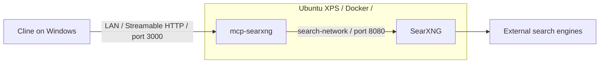

# home-ai-lab

A home AI lab with a working, self-hosted web search service connected to Cline over the local network.

**Current status:** Docker is installed on the Ubuntu XPS server. SearXNG and its MCP server run in Docker, their ports are published for LAN access, and Cline is configured to use the remote MCP endpoint. Search and page reading have been verified.

This README describes the setup and project scope at an epic level. [CHANGELOG.md](CHANGELOG.md) records completed work. GitHub Projects is the place for planned work and task-level progress.

## What is set up

| Component | Implemented state |
|-----------|-------------------|
| Ubuntu XPS server | Docker installed; server address used by the client is `<Internal-IP>`. |
| SearXNG | `searxng/searxng:latest` image pulled and running as the `searxng` container; host port `8080` published. |
| SearXNG MCP server | `isokoliuk/mcp-searxng:latest` image pulled and running as `mcp-searxng`; host port `3000` published. |
| Container connection | Both services use `search-network`; MCP connects to SearXNG at `http://searxng:8080`. |
| Cline connection | Enabled Streamable HTTP connection to `http://<Internal-IP>:3000/mcp`. |
| Cline project rules | `.clinerules/` and `memory-bank/` moved from `second-brain` to this repository. |

The server setup was performed manually. There is no committed Docker Compose deployment or server provisioning configuration in this repository.

## Current search architecture



SearXNG supplies search results. The MCP server exposes search and page-reading tools to Cline. Self-hosting this service does not make the searches offline; queries still reach external search engines.

## Cline configuration

Cline's active MCP settings are user-level, outside this repository:

```text
%USERPROFILE%\.cline\data\settings\cline_mcp_settings.json
```

Sanitized configuration example (substitute the server address for `<Internal-IP>` in your local settings):

```json
{
  "mcpServers": {
    "searxng": {
      "type": "streamableHttp",
      "url": "http://<Internal-IP>:3000/mcp",
      "disabled": false,
      "autoApprove": []
    }
  }
}
```

The connection was previously changed from launching a local Docker MCP process to using the persistent remote service. Moving the project folders did not require another MCP settings change. Open `home-ai-lab` as the Cline workspace to use its project rules.

## Verification and current limitations

The October 9, 2026 migration check used an independent MCP client with Cline's configured endpoint. It verified:

- TCP connectivity to `<Internal-IP>:3000`.
- MCP initialization and discovery of four tools.
- A `searxng_web_search` call returning three results.
- A `web_url_read` call returning page content.

The server identified itself as `ihor-sokoliuk/mcp-searxng` version `2.5.1`. The running Cline UI was not exercised during this check.

Search works with partial engine coverage: Brave reported `too many requests`, and DuckDuckGo reported `CAPTCHA`. These warnings did not prevent results from being returned.

Ports `8080` and `3000` are published for local-network use. Authentication, effective firewall restrictions, SSH hardening and public-internet reachability have not been verified as part of this work; they are not claimed as completed controls.

## Epic overview

| Epic | Current status |
|------|----------------|
| Local search infrastructure | Implemented manually on the Ubuntu server. |
| Cline search integration | Remote MCP configured and endpoint tested; project rules migrated. |
| Reproducible infrastructure | Not implemented in this repository. |
| Network and access hardening | Controls not verified; LAN connectivity is working. |
| Agent audit logging | Not implemented. |
| Local model evaluation | No evaluation harness implemented. |
| Second-brain integration | Not implemented. |

Detailed plans, tasks and scheduling belong in GitHub Projects. This table summarizes scope and present status; it is not a task backlog.

## Repository layout

```text
home-ai-lab/
├── README.md
├── CHANGELOG.md
├── .gitignore
├── .clinerules/
│   ├── coding.md
│   ├── memory_bank.md
│   ├── privacy.md
│   └── search.md
└── memory-bank/
    ├── activeContext.md
    └── decisions.md
```

The memory bank preserves working context and implementation decisions for Cline. Local reference documents, generated outputs and temporary work files are gitignored. Continue's configuration remains in `second-brain` and was not included in the Cline migration.

## Author

**Jose de Lima**

Lead Automation Engineer with 20+ years in QA and test automation, focused on AI/LLM test engineering and model evaluation.
