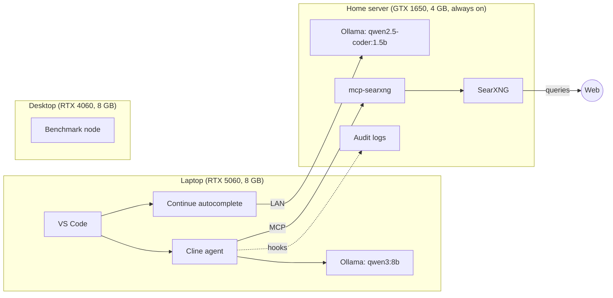

# home-ai-lab

A self-hosted, multi-node AI coding and research stack built on consumer hardware, with private web search, agent audit logging, and an evaluation harness that measures how reliably local language models handle agentic tool use.

> **Status:** In active development. See the [Roadmap](#roadmap) for what is working today and what is in progress.

## Why this exists

Cloud AI coding assistants are capable, but they come with usage caps, subscriptions, and code leaving your machine. I wanted a setup that runs entirely on hardware I already own, keeps my data on my network, and gives me an honest answer to a practical question:

**Can small local models be trusted to act as coding agents, and where exactly do they fail?**

While building the stack I watched local models fake tool calls, loop on shell quoting errors, and report success on tasks they never completed. Instead of treating that as a dead end, this project turns those failures into measurable, repeatable tests.

## What it does

- **Local agentic coding** with [Cline](https://github.com/cline/cline) driving a local model through [Ollama](https://ollama.com)
- **Inline code autocomplete** with [Continue](https://github.com/continuedev/continue), offloaded to a separate server so the main GPU stays free for the agent
- **Private web search** through a self-hosted [SearXNG](https://github.com/searxng/searxng) instance, exposed to the agent through the [mcp-searxng](https://github.com/ihor-sokoliuk/mcp-searxng) MCP server. No API keys, no third-party search accounts.
- **Agent audit trail** that logs every task and tool call, so agent behavior can be reviewed and improved over time *(in progress)*
- **Evaluation harness** that scores local models on tool-call validity, task success, and hallucinated completions *(planned)*

## Architecture



### Hardware

| Node | Role | CPU | RAM | GPU |
|------|------|-----|-----|-----|
| Laptop | Agent workstation | Intel i7-13620H | 32 GB | RTX 5060 Laptop, 8 GB |
| Home server | Always-on services, autocomplete model | Intel i7-9750H | 30 GB | GTX 1650 Mobile, 4 GB |
| Desktop | Second benchmark node | Intel i7-14700F | 32 GB | RTX 4060, 8 GB |

### Design decisions

Each significant choice is documented as a decision record in [`docs/decisions/`](docs/decisions/), including:

- Cline over OpenCode as the agent harness
- Self-hosted SearXNG over Brave, Perplexity, and Firecrawl for search
- Splitting the agent model and autocomplete model across separate machines
- Running Ollama natively on Windows instead of inside WSL

## Security

Ollama exposes its API with **no authentication**. Anyone who can reach port 11434 can use the models. The same is true of the SearXNG instance. Because of that, network restriction is the primary security control in this stack:

- Ollama (`11434`) and SearXNG (`8080`) are allowed only from the local subnet via `ufw`
- SSH to the server uses key-based authentication only
- Secrets such as the SearXNG `secret_key` live in a gitignored `.env` file and are never committed
- Nothing in this stack is exposed to the internet

See [`server/firewall/`](server/firewall/) for the exact rules.

## Repository layout

```
homelab-ai-stack/
├── README.md
├── docs/
│   ├── architecture.md
│   ├── decisions/        # Architecture decision records
│   └── lessons-learned.md
├── server/               # Docker Compose, SearXNG config, Ollama override, firewall rules
├── clients/              # Cline, Continue, and MCP configs, .clinerules
├── hooks/                # Audit logging scripts
├── evals/                # Evaluation harness, task definitions, results
└── scripts/              # Per-node setup scripts
```

## Getting started

> Setup instructions will be filled in as each phase is completed and verified on a clean install.

### Prerequisites

- An NVIDIA GPU with current drivers
- [Ollama](https://ollama.com)
- [Docker](https://www.docker.com)
- [VS Code](https://code.visualstudio.com) with the Cline and Continue extensions


## Roadmap

| Phase | Description | Status |
|-------|-------------|--------|
| 0 | Repo foundation, architecture, decision records | 🟡 In progress |
| 1 | Infrastructure as code (Docker Compose, Ollama config, setup scripts) | ⬜ Planned |
| 2 | Networking and security (DHCP reservation, SSH keys, firewall rules) | ⬜ Planned |
| 3 | Client configuration (Cline, Continue, MCP, rules) | 🟡 Working locally, not yet in repo |
| 4 | Agent audit trail via Cline hooks | ⬜ Planned |
| 5 | Evaluation harness for local model tool use | ⬜ Planned |
| 6 | Second brain vault built on the stack | ⬜ Planned |
| 7 | Lessons learned write-up | ⬜ Planned |

## Evaluation harness (planned)

The goal is a repeatable test suite that sends agentic tasks directly to the Ollama API with tool definitions and scores each model on:

- **Tool-call validity:** correct tool name and correctly named parameters
- **Task success:** whether the requested outcome actually happened, such as a file existing and its code running
- **Hallucinated completion:** the model claiming success when no tool was called
- **Performance:** tokens per second, GPU offload percentage, and context size

Results will be published here as a comparison table across models and hardware.

## Lessons learned

Building this surfaced several real-world issues, each documented with symptoms, root cause, and fix in [`docs/lessons-learned.md`](docs/lessons-learned.md). Highlights:

- A discrete GPU that intermittently disappeared from Windows, traced to an out-of-date launch BIOS, a generic Windows Update driver, and Fast Startup preserving a bad hardware state
- A local model inference running 100% on CPU because the GPU driver had silently failed
- Context window settings pushing the model past available VRAM and spilling to CPU
- An MCP server failing with `spawn docker ENOENT` because Docker was not on the editor's PATH
- A search container that was running but unreachable because its port was never published

## Author

**Jose de Lima**
Lead Automation Engineer with 20+ years in QA and test automation, focused on AI/LLM test engineering and model evaluation.