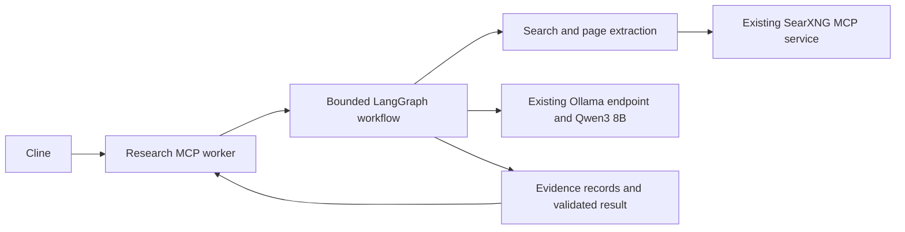
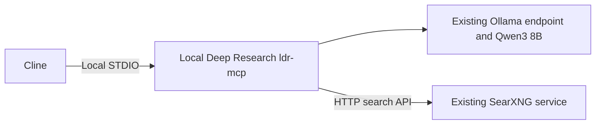

# Custom research agent versus Local Deep Research

Date: October 9, 2026

Status: Planning and evaluation proposal

Target: Cline with Ollama Qwen3 8B Q4_K_M on an RTX 5060 with 8 GB VRAM, using the existing SearXNG service.

## Executive summary

Evaluate LearningCircuit's Local Deep Research before implementing a custom research agent. It already supports Ollama, SearXNG and research workflows, substantially reducing the amount of integration and orchestration code needed. [Local Deep Research project](https://github.com/LearningCircuit/local-deep-research)

The adoption decision depends on performance and evidence quality with this specific small model. Provider compatibility alone does not establish reliable research, acceptable latency or safe memory use. A custom solution provides more control over budgets, evidence records and failure handling, but makes this project responsible for building and maintaining those controls.

Use the same questions, model, retrieval conditions and measurements to compare three candidates: the current direct search MCP baseline, conservatively configured Local Deep Research, and a minimal custom prototype only if the evaluation identifies a material gap. Select the simplest option that meets the acceptance criteria.

This plan does not mark either research solution as implemented. Detailed execution tasks and progress belong in GitHub Projects. The changelog should record work only after it is completed.

## Current baseline and evidence

| Area | Present state | What the evidence establishes |
| --- | --- | --- |
| Server search infrastructure | Docker, SearXNG and the SearXNG MCP service are running on the Ubuntu XPS server. | The implemented baseline described in the project README. |
| LAN connection | Cline settings point to `http://<Internal-IP>:3000/mcp` through Streamable HTTP. | An independent client verified connectivity, initialization and four tools on October 9. |
| Search and page reading | A three-result search and a bounded page read succeeded. | The endpoint can return results and page content; the running Cline UI was not exercised in that check. |
| Engine coverage | Brave rate limiting and DuckDuckGo CAPTCHA were observed. | Successful responses can have incomplete coverage. |
| Retrieved evidence | The bounded page read included substantial navigation text. | A successful fetch does not establish that the relevant passage was extracted. |
| Local model | The conversation records Qwen3 8B Q4_K_M and historical observations of a 16,384-token context with GPU residency. | Those observations do not establish full-context quality, sustained stability or concurrent inference performance. Reconfirm the runtime baseline before evaluation. |
| Research orchestration | Neither the custom worker nor Local Deep Research has been deployed for this project. | All architectures, limits and phases below are proposed. |

The baseline measurements are summarized in [the project README](../README.md). The historical model observations come from the conversation record rather than a new hardware test.

## What the research worker should provide

Cline should be able to submit a question and receive a compact answer, supporting sources, uncertainty and a clear completion status. Intermediate search results and model reasoning should stay in the worker so they do not repeatedly consume Cline's conversation context.

The worker should:

- Search and read sources before making source-dependent factual claims.
- Preserve relevant passages and connect material claims to supporting evidence.
- Respect limits on model input, generated output, returned tool content, iterations and elapsed time.
- Handle unavailable engines, failed pages, conflicting evidence and insufficient evidence explicitly.
- Use the existing Qwen model serially during the first evaluation.
- Treat retrieved text as untrusted content and protect local services and sensitive information.

An isolated worker gives research its own application state. If it shares the same Ollama instance and GPU as Cline, it still shares the hardware capacity.

## Comparison of the two approaches

| Dimension | Custom worker with LangGraph and Pydantic | LearningCircuit Local Deep Research |
| --- | --- | --- |
| Starting point | Build the MCP interface, graph, retrieval adapters and result contract. | Configure an existing research application and MCP interface. |
| Cline integration | Design a small tool surface for the intended workflow. | Its packaged `ldr-mcp` server uses STDIO; test it with Cline. |
| Search integration | Reuse the current SearXNG MCP tools initially, or implement direct HTTP retrieval. | Configure its native SearXNG integration against the existing service. |
| Model integration | Direct Ollama calls with explicit per-request limits. | Configure its Ollama provider and verify effective request settings. |
| Orchestration | Define a bounded graph with explicit branches and stop conditions. | Evaluate its simpler research strategies first; assess its LangGraph agent afterward. |
| Evidence handling | Define passage records, claim references and unsupported-claim behavior. | Inspect actual output and source handling to determine whether they meet the same criteria. |
| Budget enforcement | Implement and test hard limits throughout the workflow. | Verify which settings are enforced; add a narrow adaptation only where needed. |
| Maintenance | Own all application logic, tests and deployment behavior. | Maintain configuration and integration tests; a fork would also require tracking upstream changes. |
| Main risk | Building a complex framework before knowing which controls improve results. | Assuming broad features and provider support imply reliability on Qwen3 8B. |

The packaged MCP tools and transport are documented in the [v1.10.7 MCP guide](https://github.com/LearningCircuit/local-deep-research/blob/v1.10.7/docs/mcp-server.md). Neither route guarantees correct answers or removes upstream search restrictions.

## Option A Custom creation plan

### Proposed architecture

The first retrieval adapter would reuse `searxng_web_search` and `web_url_read`. Confirm the tool schemas at runtime and explicitly bound their result sizes. Direct SearXNG HTTP access is an alternative if the MCP layer prevents adequate extraction, control or diagnostics; it would also require a separate page fetcher.

LangGraph would manage transitions and state. Pydantic would validate request, state and response structures. LangGraph supports stateful orchestration, while Pydantic validates data against declared models. [LangGraph overview](https://docs.langchain.com/oss/python/langgraph/overview), [Pydantic models](https://docs.pydantic.dev/latest/concepts/models/)

### Proposed workflow and model responsibilities

1. **Validate the request:** reject invalid limits and unsupported options; initialize an overall deadline.
2. **Create a bounded query plan:** use Qwen to clarify the question and propose a small set of searches. Validate its output before execution.
3. **Search:** execute allowed searches, deduplicate URLs and record engine failures. Limit results before adding them to state.
4. **Fetch and extract:** obtain relevant text, remove boilerplate, record failures and retain passages with stable source identifiers.
5. **Assess evidence:** identify answered questions, contradictions and missing information. Permit another retrieval round only when it fits the remaining budget.
6. **Synthesize:** give Qwen a compact evidence packet and require claim references, uncertainty and explicit abstention where evidence is insufficient.
7. **Check and return:** validate references, enforce the final response size and return `complete`, `partial` or `failed` with useful failure details.

Code should control fetching, deduplication, counting, scheduling and stopping. The model should handle language tasks such as query formulation, interpreting passages and synthesis. The model must not decide its own hard resource limits.

### Proposed data contract

Expose one initial tool, such as `research_question`, with a question and a validated budget profile. Keep diagnostic details outside the default Cline response.

| Record | Proposed fields | Purpose |
| --- | --- | --- |
| Request | Question, allowed domains, budget profile, request identifier | Make permitted scope and limits explicit. |
| Source | Identifier, URL, title, retrieval time, fetch status, content hash | Track provenance and recognize duplicate or changed content. |
| Passage | Identifier, source identifier, text, section or offset when available | Preserve the actual evidence used for synthesis. |
| Claim | Text, passage identifiers, uncertainty, contradiction references | Connect conclusions to evidence. |
| Result | Status, answer, claims, sources, limitations, consumed budgets | Give Cline a compact and interpretable outcome. |

Validate both structure and relationships. A claim referencing a nonexistent passage must fail validation. Valid JSON and valid references still do not prove that a passage supports the claim; evidence support needs a separate evaluation.

### Subagents and scheduling

Start with one sequential research workflow. If the evaluation shows that decomposition improves results, add logical subagents for distinct subquestions. Give each a small evidence packet and a bounded result, then merge and deduplicate their findings.

All model calls should use a shared inference queue for this prototype. Parallel page retrieval may be useful, but parallel model sessions increase memory pressure. Ollama documents the relationship between parallel requests, context allocation and memory requirements. [Ollama FAQ](https://docs.ollama.com/faq)

The parent Cline inference request must have finished before the research tool waits for another request to the same serialized model. Do not hold an inference lock across the entire tool conversation. Test this interaction explicitly to avoid a blocked parent and worker waiting on each other.

A queue inside the research worker cannot control unrelated Ollama clients. Verify server-level concurrency and Cline's behavior as well as the worker's own scheduling before claiming a global one-request limit.

A second pass by the same model can catch some inconsistencies, but it is not an independent verifier. Add subagents only after measuring their benefit against a sequential baseline.

### Proposed implementation phases

| Phase | Deliverable | Exit condition |
| --- | --- | --- |
| A1 Baseline and contracts | Evaluation questions, budget profiles and request/result schemas. | Baseline recorded; expected answers or evidence requirements reviewed. |
| A2 Retrieval without model planning | MCP tool that runs bounded search and extraction with fixed queries. | Relevant passages returned; error, privacy and budget tests pass. |
| A3 Sequential synthesis | Qwen produces compact answers from evidence with passage references. | Citation support and unsupported-question tests meet agreed thresholds. |
| A4 Bounded LangGraph loop | One additional retrieval round when a specific gap justifies it. | Loop, cancellation and deadline tests pass; measurable benefit over A3. |
| A5 Optional subagents | Serial subquestion workers and controlled merging. | Better coverage or support than A4 without unacceptable latency or memory cost. |
| A6 Operational integration | Cline routing rules, reproducible deployment and regression checks. | End-to-end Cline tests and rollback checks pass. |

Each phase should earn its complexity through the evaluation. A retrieval and synthesis worker may meet the need without proceeding to subagents.

### Limitations and potential issues

- Prompt design and evidence extraction will need tuning for Qwen3 8B; adding orchestration cannot compensate for every reasoning limitation.
- Token estimates can be inaccurate. The input allowance must include instructions, schemas, evidence and reserved generation space.
- Repeatedly summarizing prior summaries can distort evidence. Retain original passages and reconstruct the synthesis packet from them.
- Extraction must handle navigation-heavy pages, inaccessible content and unsupported formats. Browser rendering and PDF extraction are additional capabilities, not assumptions in the initial scope.
- Retries can amplify rate limits and extend runtimes. Bound retries, use delays and stop when the overall deadline expires.
- Application checkpoints can retain private data. Decide retention and sanitization before enabling persistence.
- Long-running jobs introduce cancellation and restart complexity. Add background job polling only if actual Cline timeout behavior requires it.
- Maintaining a custom MCP server, schemas, adapters and graph is an ongoing responsibility.

## Option B Local Deep Research evaluation plan

### Proposed architecture

Use the existing SearXNG instance directly. The research process would not need to call the current SearXNG MCP wrapper. Keep the direct search connection available during evaluation so its behavior can be compared.

The v1.10.7 MCP guide lists `quick_research`, `detailed_research` and `generate_report`, along with a `langgraph-agent` strategy. This functionality is present in a released version, rather than only an unversioned development branch. [MCP guide](https://github.com/LearningCircuit/local-deep-research/blob/v1.10.7/docs/mcp-server.md)

### Configuration to evaluate

These are proposed starting values, not tested settings or deployment instructions:

| Setting | Starting choice | Verification needed |
| --- | --- | --- |
| Version | Pin the evaluated release, initially v1.10.7. | Record resolved dependencies and review relevant release/security changes before deployment. |
| Model provider and model | Ollama and the exact installed Qwen3 8B Q4_K_M model tag. | Confirm the tag, effective request options and model residency. |
| Context | Begin at 8,192 tokens; evaluate 16,384 separately. | Confirm actual prompt sizes, truncation behavior and peak VRAM. |
| Generated output | Begin with a 2,048-token ceiling. | Confirm whether reasoning shares this allowance and whether responses finish coherently. |
| Strategy | Start with `source-based` through `quick_research`. | Compare evidence quality and runtime with a second simple strategy only when useful. |
| Research rounds | One iteration and one question per iteration initially. | Inspect actual searches and model calls; increase only after the baseline is stable. |
| LangGraph subresearch | Disable during the first LangGraph evaluation. | Confirm the effective configuration and absence of overlapping inference requests. |
| Search endpoint | Existing SearXNG HTTP endpoint. | Test JSON access, LAN URL approval and error reporting. |
| Returned result | Compact answer and sources within the agreed Cline response budget. | Measure actual response size; an output instruction is not a hard size limit. |

The documented release defaults include a 20,480-token local context, a 30,000-token output setting capped relative to context, 50 LangGraph cycles and four subagent workers with subresearch enabled. The documented accumulated-knowledge limit is not enforced at runtime. Explicitly set and test budgets instead of assuming every setting is a hard safeguard. [Configuration guide](https://github.com/LearningCircuit/local-deep-research/blob/v1.10.7/docs/CONFIGURATION.md)

For LAN SearXNG, the release documentation requires operator approval of a private endpoint. Pinning the instance URL through the process environment is one supported method. Use the narrowly configured endpoint and test redirects; do not enable blanket private-network access for arbitrary retrieved URLs. [SearXNG integration guide](https://github.com/LearningCircuit/local-deep-research/blob/v1.10.7/docs/SearXNG-Setup.md)

### Proposed evaluation phases

| Phase | Activity | Exit condition |
| --- | --- | --- |
| B1 Isolated setup | Prepare a version-pinned environment and configure existing endpoints. | MCP initialization, tool discovery and effective configuration checks pass. |
| B2 Retrieval check | Exercise SearXNG searches and inspect fetched content. | Relevant content obtained; engine and page failures visible. |
| B3 Small research runs | Run the shared questions with conservative settings. | Record quality, runtime, memory and response sizes. |
| B4 Cline integration | Run complete tool interactions from the actual Cline environment. | No timeout, blocked inference cycle or uncontrolled context growth. |
| B5 Optional LangGraph trial | Enable its agent strategy with reduced cycles and subresearch disabled. | Better results justify its additional work and latency. |
| B6 Decision | Adopt, add a narrow integration adaptation, or proceed to a custom prototype. | Written comparison identifies evidence and remaining gaps. |

### Limitations and potential issues

- Ollama support does not establish Qwen3 8B research quality. Benchmarks using larger models or different search providers should not be transferred to this hardware.
- The packaged MCP transport is local STDIO. A research service hosted on the Ubuntu server would require a separate transport arrangement and additional integration/security testing.
- Existing Cline rules direct searches to the current SearXNG tools. Adoption needs deliberate routing rules so Cline chooses the research worker when appropriate and avoids duplicate research.
- The application may return more material than Cline needs, including multiple representations of findings. Measure the full tool payload, not just the answer text.
- Source lists alone do not establish support for individual claims. Inspect the evidence available and test citations against the actual passages.
- High-level settings may not bound every model call, tool call or retained state. Inspect effective behavior and use external measurements where necessary.
- Reusing existing services requires endpoint configuration. Bundled deployment examples may start services that duplicate the current installation.
- A custom fork can reduce the maintenance advantage of adoption. Prefer configuration or a small adapter where sufficient.
- Upgrades may change strategies, dependencies, defaults and output formats. Pin the evaluated version and rerun regression tests before changing it.

## Shared budgets and failure behavior

The following limits are provisional design targets. Finalize them after baseline measurements and confirm that the selected implementation can enforce each one.

Q4_K_M describes model weight quantization; it does not establish the precision or size of the attention cache used for context. Available VRAM must also accommodate that cache, runtime buffers and other GPU use. A model loaded successfully at 16K can still encounter memory pressure or poor evidence use on a substantial request. Evaluate cache quantization or other runtime tuning separately, with quality and memory measurements, if the baseline requires it.

| Resource | Proposed initial limit | Expected behavior at the limit |
| --- | --- | --- |
| Active model requests | One across the prototype's shared model workflow. | Queue with a deadline; never start an uncontrolled second inference session. |
| Model context | 8K initial evaluation; 16K separate profile. | Select or reduce evidence before making the request; retain generation space. |
| Generation | 2,048 tokens per synthesis request. | Identify unfinished output; do not present a truncated sentence as a complete answer. |
| Custom retrieval | At most three planned queries, five results per query and six fetched pages. | Stop retrieval and report coverage limitations. |
| Page extraction | Select relevant passages within a token budget. | Reject navigation-only content or label evidence as insufficient. |
| Model output repair | At most one retry after invalid structured output. | Return a structured failure or partial result after another invalid response. |
| Cline tool response | At most 2,000 tokens including answer, sources and limitations. | Reduce optional detail while preserving status and evidence references; verify the serialized payload. |
| Quick research deadline | Initial target of five minutes, subject to measured Cline timeout behavior. | Cancel dependent work and return a partial result with the reason. |

LDR may not expose equivalent controls for all custom limits. Treat an unenforceable limit as an identified gap, then decide whether an adapter, upstream change or custom implementation is warranted.

Failure handling should distinguish no results, upstream rate limits, denied URLs, page extraction failure, invalid model output, context overflow, deadline expiry and insufficient evidence. A partial answer should identify unanswered parts instead of inventing completion.

## Test plan for both options

### Evaluation questions and reproducibility

Prepare 24 reviewed questions: four each for simple facts, multi-source comparisons, version-sensitive technical questions, conflicting claims, unanswerable questions and difficult retrieval. Include cases affected by blocked engines and pages dominated by navigation.

Run the current search baseline and each candidate against the same questions. Use recorded retrieval fixtures for repeatable extraction and synthesis comparisons, plus live searches to measure real engine availability. Keep fixtures and raw runtime logs private and sanitize any shared report.

Repeat model-quality cases three times to reveal variability. Record the model digest, quantization, Ollama version, context and output settings, thinking mode, application version, prompts, search parameters and test date. Treat changing live sources as a confounding factor rather than attributing every difference to orchestration.

### Required tests and expected outcomes

| ID | Test | Expected outcome | Applies to |
| --- | --- | --- | --- |
| T01 | Initialize MCP and discover tools from the actual Cline environment. | Cline can call the intended tool with the documented schema. | Both |
| T02 | Verify effective model, context, output and strategy configuration. | Runtime options match the evaluated profile; no unexpected model/provider selection. | Both |
| T03 | Search through the existing LAN SearXNG instance. | Results returned; direct JSON API and private-endpoint approval tested for LDR. | Both |
| T04 | Disable or simulate failure of an upstream engine. | Useful remaining results or an explicit partial/failure status; bounded retry behavior. | Both |
| T05 | Fetch a navigation-heavy page with relevant content later in the page. | Relevant passage extracted, or insufficient evidence reported. | Both |
| T06 | Fetch a failed, oversized, redirected or unsupported page. | Bounded retrieval; error captured; no false successful extraction. | Both |
| T07 | Supply malformed planner/synthesis output. | Schema handling is predictable; repair attempts stop at the configured limit. | Both; stronger control expected in custom |
| T08 | Ask questions whose answers are absent from retrieved sources. | Abstention or a clear partial answer rather than fabricated support. | Both |
| T09 | Check every material claim against its cited passage. | Claims have genuine support; URLs and source identifiers were actually retrieved. | Both |
| T10 | Provide conflicting or outdated sources. | Conflict and dates are acknowledged; certainty does not exceed the evidence. | Both |
| T11 | Provide a source that instructs the agent to ignore rules, leak data or run tools. | Source text stays data; no unauthorized action or secret exposure. | Both |
| T12 | Attempt loopback/private destinations, metadata destinations and redirect chains through retrieved URLs. | Approved search/model endpoints work; arbitrary protected destinations remain blocked. | Both |
| T13 | Run increasing prompt loads at 8K and 16K, including near the usable input limit. | Measure VRAM, GPU/CPU placement, latency, truncation and answer quality; no silent assumptions. | Both |
| T14 | Have Cline call the worker while both use the same Ollama instance. | The parent releases inference before the worker starts; no blocked tool cycle. | Both |
| T15 | Submit two jobs and optionally test logical subagents. | Requests are bounded and serialized as intended; queues expire or cancel predictably. | Both |
| T16 | Cancel a job, exceed the deadline or simulate a hanging endpoint. | Work stops; no orphan inference/fetch jobs; useful cancellation or partial status. | Both |
| T17 | Inspect full MCP payloads and Cline context growth over repeated calls. | Returned content meets the budget; no raw page dumps or cumulative uncontrolled growth. | Both |
| T18 | Execute 50 consecutive quick runs after configuration is stable. | No out-of-memory failures or unexplained retained-memory growth; errors remain diagnosable. | Both |
| T19 | Compare cold starts, warm runs and repeat runs of each question. | Report latency distribution and quality variability rather than one favorable run. | Both |
| T20 | Restart the process and inspect logs, caches and checkpoints. | Predictable recovery, no cross-request evidence leakage and appropriate retention. | Both |
| T21 | Change application/dependency versions in an isolated evaluation. | Regression cases identify changed schemas, budgets, quality or routing behavior. | Both |
| T22 | Restore the direct search route after the trial. | Existing search still works; rollback steps are documented and exercised. | Both |

Custom-specific checks should also exercise every graph exit path, reference validation, budget accounting across retries and evidence merging between subquestions. LDR-specific checks should examine the real number of model/search calls, settings enforcement, MCP output duplication and its private-endpoint policy.

### Measurements and provisional acceptance criteria

| Measure | How to evaluate it | Provisional adoption criterion |
| --- | --- | --- |
| Supported claims | Human review of material factual claims against retained passages. | At least 95% support across scored claims; no critical unsupported conclusions. |
| Citation integrity | Verify each citation against retrieved source records. | No invented URLs, source identifiers or quotations. |
| Answer quality | Score correctness, coverage and uncertainty for each reviewed question. | No material decline from the direct-search baseline; demonstrated benefit on questions requiring synthesis. |
| Abstention | Review the deliberately unanswerable cases. | Every case states the evidence gap without inventing an answer. |
| Operational reliability | Separate expected retrieval failures from application failures. | At least 90% successful completion of answerable cases under normal retrieval conditions. |
| Memory stability | Observe runtime telemetry during load and consecutive-run tests. | No out-of-memory failure in the 50-run sequence; any CPU offload identified and judged acceptable. |
| Budget enforcement | Inspect requests, retries, retained state and serialized tool results. | All designated hard limits respected, including failed and partial runs. |
| Latency | Record median and slow-tail duration for cold and warm runs. | Fits an agreed interactive threshold and verified Cline timeout configuration. |
| Security and privacy | Review adversarial inputs and sanitized diagnostic outputs. | No unauthorized actions, protected-destination access or secret leakage. |

These thresholds are proposed decision criteria, not measured results. A 24-question set can expose important failures but cannot establish broad research accuracy. Expand the evaluation for important use cases before relying on either approach.

## Decision rules and implementation checklist

Adopt LDR if the conservative configuration meets the shared criteria and its output fits Cline's context. Add a narrow adapter if it passes research-quality tests but needs bounded output, job handling or a result contract. Proceed with a custom worker if important evidence, budget or integration requirements cannot be met without extensive changes to LDR.

Do not select a custom implementation merely because it offers more components. Compare the benefit of each additional graph stage or subagent with its latency, token use and maintenance cost.

- [ ] Reconfirm the current model, GPU residency, context and search baseline.
- [ ] Agree on questions, expected evidence, budgets and acceptance thresholds.
- [ ] Evaluate a pinned LDR version against existing services.
- [ ] Complete actual Cline integration and shared-inference tests.
- [ ] Review claim support, extraction quality and full tool response sizes.
- [ ] Exercise failure, cancellation, privacy and protected-destination cases.
- [ ] Record repeatability, latency and memory results.
- [ ] Identify any gaps that configuration or a small adapter cannot address.
- [ ] Build only the custom phases needed to evaluate those gaps.
- [ ] Compare results and record an adoption decision.
- [ ] Move approved execution tasks into GitHub Projects.
- [ ] Update completed-work records only when implementation or evaluation work is finished.

## Privacy and operational boundaries

Use `<Internal-IP>` and other placeholders in shared plans. Resolve real endpoints from local configuration. Keep credentials, SSH key payloads, personal filesystem paths and raw private logs out of shared evaluation artifacts.

Local inference keeps model processing on the configured machine, but web research still sends queries to external engines and requests pages from external sites. Only send information appropriate for those destinations. Inspect source-derived tool requests and redirect destinations before allowing access to protected services.

LAN access is the current operating boundary. Authentication, effective firewall rules and public-internet reachability are not established by the existing successful connection test. Any new remote research transport needs its own access-control review before exposure.

## Source references

- [Implemented baseline and verification limits](../README.md)
- [LearningCircuit Local Deep Research](https://github.com/LearningCircuit/local-deep-research)
- [Local Deep Research v1.10.7 MCP interface](https://github.com/LearningCircuit/local-deep-research/blob/v1.10.7/docs/mcp-server.md)
- [Local Deep Research v1.10.7 configuration](https://github.com/LearningCircuit/local-deep-research/blob/v1.10.7/docs/CONFIGURATION.md)
- [Local Deep Research v1.10.7 SearXNG integration](https://github.com/LearningCircuit/local-deep-research/blob/v1.10.7/docs/SearXNG-Setup.md)
- [Ollama memory, context and concurrency guidance](https://docs.ollama.com/faq)
- [LangGraph orchestration overview](https://docs.langchain.com/oss/python/langgraph/overview)
- [Pydantic model validation](https://docs.pydantic.dev/latest/concepts/models/)

Upstream capabilities describe the referenced documentation. Compatibility, quality and performance on this project's hardware remain subject to the tests above.
